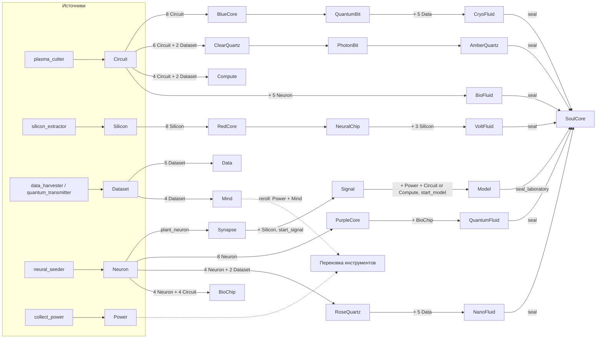

# Организм AOF: одна 3D-лаборатория для 27 ресурсов и 5 типов инструментов

Статус: **фаза 1 (только просмотр) реализована и смержена, решения фазы 2 зафиксированы в разделе 11.** Все связи ресурсов взяты из `aof-core/src`, а не из описаний.

## 1. Главный принцип

3D-организм — это **чистое представление** (view) поверх уже существующих данных цепочки и API.

- Не меняем NFT: ни минт, ни метаданные, ни `ToolMetadataRegistry`, ни коллекцию.
- Не меняем контракт, рецепты, лимиты выпуска и экономику.
- Не добавляем новых источников ресурсов. Организм показывает существующие потоки, а не создаёт новые.
- Любая новая механика (например, инструмент как ускоритель) — отдельное решение с экономическим ревью (см. `docs/AOF_ECONOMIC_INVARIANTS.md`).

Три слоя, как обсуждали:

| Слой | В организме | Источник истины | Что делает 3D |
|---|---|---|---|
| 1. Презентация | 3D-сцена, анимации, эффекты | — | Показывает, не решает |
| 2. Активы | 5 типов инструментов (SPL NFT), их редкость и прочность | Цепочка (токен + `ToolData`) | Только читает |
| 3. Экономика | 27 балансов, таймеры лаборатории, крафт, энергия | Цепочка + API | Только читает |

## 2. Как внедрить модели, не трогая NFT

### 2.1. Инструменты: модель по (тип, редкость)

Всё, что нужно для выбора модели, уже есть на чейне в `ToolData`:

- `tool_type` — один из 5 типов (`plasma_cutter`, `silicon_extractor`, `data_harvester`, `quantum_transmitter`, `neural_seeder`);
- `rarity` — одна из 5 редкостей (`common` … `legendary`);
- `mint` — адрес конкретного токена.

Значит модель привязывается **на клиенте**, по этим полям. NFT и его JSON не меняются.

Схема:

```
ToolData (on-chain, уже читается /query/my-tools)
   tool_type + rarity
        │
        ▼
models3d/manifest.json   ← версионированный файл в нашем фронтенде
   tools[tool_type].model      → один GLB на тип (5 мешей)
   tools[tool_type].rarity[r]  → материал / свечение / цвет (25 вариантов без 25 мешей)
   mintOverrides[mint]         → опционально, для особых экземпляров
        │
        ▼
3D-модель, а если её нет — существующий 2D-плейт (TOOL_RARITY_PLATE)
```

Редкости уже есть в UI: common = Base, uncommon = Enhanced, rare = Quantum, epic = Singularity, legendary = Transcendent. Модель используем те же имена, чтобы не плодить новые.

### 2.2. Ресурсы: по каноническому id

27 ресурсов уже перечислены в `frontend/src/lib/visualAssets.ts` (`RESOURCES`: 26 в `PLAYABLE_RESOURCES` + `soulCore`). Ресурсы — это SPL-балансы, а не NFT, поэтому привязка идёт по `id` и ничего on-chain не требует.

### 2.3. Пример манифеста (черновик)

```json
{
  "version": 1,
  "tools": {
    "plasma_cutter": {
      "model": "/assets/models3d/tools/plasma_cutter.glb",
      "sha256": "TBD",
      "rarity": {
        "common":    { "emissive": "#2a6f8a", "intensity": 0.2 },
        "legendary": { "emissive": "#f2c14e", "intensity": 1.0 }
      }
    }
  },
  "resources": {
    "circuit": { "organ": "base", "model": "/assets/models3d/resources/circuit.glb", "sha256": "TBD" }
  },
  "mintOverrides": {}
}
```

Поля `sha256` нужны, чтобы проверять целостность модели, которую клиент загружает с нашего origin.

### 2.4. Честный компромисс

3D видно только в нашем клиенте. Внешние кошельки и маркетплейсы покажут 2D-картинку из NFT-метаданных. Это цена за то, что NFT не меняется. Если позже понадобится 3D во внешних местах, это будет отдельное решение с изменением метаданных.

## 3. Граф организма (проверен по коду)



Что видно из графа:

- **26 из 27 ресурсов** имеют и источник, и потребителя. Тупиков нет.
- **Compute** — топливо для обучения модели (`start_model_training`, выбор Circuit или Compute).
- **Mind** и **Power** расходуются в `reroll` (перековка двух инструментов одной редкости в один следующей).
- **SoulCore** — единственный терминальный ресурс. Его создаёт `seal_laboratory` (Model + 5 флюидов + AmberQuartz). Это естественный финал организма. Пока в коде нет ничего, что его тратит, — это вопрос к продукту.

Крафт (`craft_recipe.rs`) — мгновенный: таймеров у него нет. Лаборатория (`plant_neuron`, `start_signal_processing`, `start_model_training`) и майнинг — таймерные.

## 4. Анатомия организма

| Часть тела | Что это в игре | Источник данных |
|---|---|---|
| **Сердце** | Энергия игрока (пульс) и Power (поток) | `EnergyAccount`, `GridState.power_buffer` |
| **Тело** | Лаборатория, 10 клеток | `LabTile` 0..9 (`plant_neuron` ограничивает индекс < 10) |
| **Конечности** | 5 инструментов в доках, каждый качает свой ресурс | `ToolData`: `is_mining`, `mining_end`, `durability` |
| **Органы** | 7 групп ресурсов из раздела 3 | Балансы 27 мантов |
| **Сборка сознания** | Финальная «сборка» SoulCore | `seal_laboratory` |

Сопоставление инструментов и ресурсов (по `collect_mining.rs::resource_kind_for_tool`):

| Инструмент | Модель | Ресурс |
|---|---|---|
| `plasma_cutter` | резак | Circuit |
| `silicon_extractor` | экстрактор | Silicon |
| `data_harvester` | сборщик данных | Dataset |
| `quantum_transmitter` | передатчик | Dataset |
| `neural_seeder` | сеятель | Neuron |

## 5. Таблица 27 ресурсов

| # | Ресурс | Орган | Откуда | Куда |
|---|---|---|---|---|
| 1 | Data | база | крафт 8 (5 Dataset) | Cryo, Nano |
| 2 | Circuit | база | plasma_cutter | BlueCore, ClearQuartz, BioChip, BioFluid, Compute, fuel |
| 3 | Silicon | база | silicon_extractor | RedCore, Signal, VoltFluid |
| 4 | Neuron | модельная цепочка | neural_seeder | Synapse, PurpleCore, RoseQuartz, BioChip, BioFluid |
| 5 | Synapse | модельная цепочка | plant_neuron | Signal |
| 6 | Signal | модельная цепочка | start_signal | Model |
| 7 | Model | модельная цепочка | start_model | SoulCore |
| 8 | Power | модельная цепочка | collect_power | start_model, reroll |
| 9 | Compute | модельная цепочка | крафт 17 | fuel для start_model |
| 10 | Dataset | модельная цепочка | data_harvester, quantum_transmitter | Data, Mind, ClearQuartz, RoseQuartz, Compute |
| 11 | BlueCore | ядра | крафт 9 (8 Circuit) | QuantumBit |
| 12 | PurpleCore | ядра | крафт 11 (8 Neuron) | QuantumFluid |
| 13 | RedCore | ядра | крафт 10 (8 Silicon) | NeuralChip |
| 14 | ClearQuartz | кварцы | крафт 12 | PhotonBit |
| 15 | RoseQuartz | кварцы | крафт 13 | NanoFluid |
| 16 | AmberQuartz | кварцы | крафт 15 (PhotonBit) | SoulCore |
| 17 | QuantumBit | биты/чипы | крафт 0 (BlueCore) | CryoFluid |
| 18 | NeuralChip | биты/чипы | крафт 1 (RedCore) | VoltFluid |
| 19 | PhotonBit | биты/чипы | крафт 2 (ClearQuartz) | AmberQuartz |
| 20 | BioChip | биты/чипы | крафт 14 | QuantumFluid |
| 21 | CryoFluid | флюиды | крафт 3 | SoulCore |
| 22 | VoltFluid | флюиды | крафт 4 | SoulCore |
| 23 | BioFluid | флюиды | крафт 5 | SoulCore |
| 24 | NanoFluid | флюиды | крафт 6 | SoulCore |
| 25 | QuantumFluid | флюиды | крафт 7 | SoulCore |
| 26 | Mind | особое | крафт 16 (4 Dataset) | reroll |
| 27 | SoulCore | особое | seal_laboratory | — (терминал) |

## 6. Состояние организма: только из существующих данных

Ни одна визуальная деталь не должна рождаться без данных цепочки.

| Что анимируем | Источник | Как считаем |
|---|---|---|
| Рост плитки | `LabTile.startedAt`, `readyAt` | Бэкенд уже считает `progress` (`query.ts` ~586–603) |
| Работа инструмента | `ToolData.is_mining`, `mining_end` | Таймер на клиенте, сверка с API |
| Поток сигнала/модели | `SignalState`, `ModelState` (`in_progress`, `ready_at`) | Состояние стадии |
| Пульс энергии | `EnergyAccount.current` | Текущее значение |
| Запасы ресурсов | 27 балансов | Размер органа / интенсивность свечения |
| Сборка SoulCore | факт `seal_laboratory` | Баланс SoulCore изменился |

Важно про время: сервер считает `now` в секундах, клиентские часы могут врать. Поэтому API должен отдавать `serverNow`, а клиент считает смещение один раз.

Правило из `nicechunk` (Apache-2.0, см. предыдущий ресерч): анимация на нажатии не равна подтверждённой транзакции. Например, «сбор» на 3D показываем только после того, как баланс изменился.

## 7. Архитектура кода (когда начнём)

```
frontend/src/organism/
  registry.ts       27 ресурсов и 5 инструментов, привязка к RESOURCES и TOOL_NFTS
  deriveState.ts    чистая функция: снимок цепочки → визуальное состояние (тестируется без 3D)
  manifest.ts       загрузка и проверка manifest.json (sha256)
  Organism.tsx      R3F-сцена, загружается лениво
frontend/public/assets/models3d/
  manifest.json
  tools/*.glb
  resources/*.glb
```

- `deriveState.ts` — чистая функция, как редьюсеры в `farmhand` (только паттерн, код не берём). Тесты через `tsx --test`, как в остальном фронтенде.
- Сцена грузится лениво, чтобы не утяжелять кабинет. Для отказа — 2D-плейты из `visualAssets.ts`.
- Визуальные стили берём из общих токенов темы.

## 8. Риски

1. **Владение.** Авторитет — SPL-токен, а `ToolData.owner` — кэш (см. `docs/TOOL_OWNERSHIP_MODEL.md`). Станция должна показывать того, кто держит токен, и при расхождении вызывать `sync_tool_owner`.
2. **Ассеты.** Модели для игрового клиента не привязаны к NFT, поэтому CC0-заглушки здесь допустимы. Но если когда-нибудь 3D будет продаваться как часть NFT, понадобятся собственные или заказные модели.
3. **Целостность.** Клиент загружает модели с нашего origin. Без `sha256` подменённый GLB можно не заметить. Модели косметические, но они не должны ломать интерфейс.
4. **Производительность.** 27 ресурсов и 10 клеток на телефоне: LOD, один общий материал на группу, загрузка по органам, бюджет на GLB.
5. **Честность визуала.** Не показывать то, чего нет в цепочке (правило из `VIP_VISUAL_ASSETS.md`).
6. **Экономика не меняется.** Пока организм — это только view. Превращение его в механику (вариант A из прошлого ответа) требует отдельного ревью лимитов выпуска.

## 9. Решения (зафиксированы)

1. **Сердце организма — энергия игрока** (`EnergyAccount`). Персональный пульс, не общая сеть.
2. **SoulCore — будущий доступ.** Финальная сцена показывает «сборку» и статус, а что откроется, решается позже. Это не награда в текущей версии.
3. **Фаза 1 — только просмотр.** Организм показывает существующие потоки. Механики (инструмент как ускоритель и т.п.) — фаза 2, с отдельным экономическим ревью.
4. **Арт на прототип — CC0-заглушки.** Для релиза свои модели или заказ решаем отдельно.

## 10. Фаза 1: что входит в прототип

- Только чтение: 3D-сцена собирается из снимка цепочки, никаких транзакций.
- Фича-флаг, по умолчанию выключен.
- Модели-заглушки процедурные (примитивы из three.js), без скачивания ассетов. Замена на CC0 GLB — отдельным шагом через манифест.
- 2D-лаборатория не удаляется, организм — дополнительный вид.

## 11. Решения для фазы 2 (приняты пользователем, 2026-10-16)

1. **Механика инструмента в лаборатории — только визуал.** Инструмент остаётся видимым узлом органа и показывает владение, редкость, майнинг и прочность. Ускорения таймеров и отдельной линии нет: экономику, лимиты выпуска и программу это решение не трогает, отдельный PR для него не нужен.
2. **SoulCore открывает геймплейный доступ.** Финальная сцена в текущей версии по-прежнему показывает только сборку и статус, без обещания конкретной награды. Само открытие (новая зона, рецепты или лимиты) — отдельная большая задача: сначала экономический дизайн по `docs/AOF_ECONOMIC_INVARIANTS.md`, затем отдельный PR. В фазу 1 и в визуальные правки это не входит.
3. **Износ прочности при работе в лаборатории — да, с путём восстановления.** Это решение пока не реализовано и не может быть реализовано одним фронтендом: прочность живёт в `ToolData` на чейне, а при ответе «только визуал» у инструмента нет лабораторной работы, которая могла бы её тратить. Поэтому сначала нужен отдельный дизайн: что считается работой в лаборатории, сколько прочности тратится и чем она честно восстанавливается, с проверкой по `docs/AOF_ECONOMIC_INVARIANTS.md` и `docs/TOOL_OWNERSHIP_MODEL.md` (владение — SPL-токен, кэш владельца на бэкенде для экономических решений не авторитетен). До этого дизайна износ остаётся только в майнинге, как сейчас.

Полный дизайн фазы 2 (ворота SoulCore и лабораторный износ, с порядком отдельных PR) — `docs/ORGANISM_PHASE2_DESIGN.md`. На фронтенде в этой ветке сделан только просмотр: доки показывают низшую прочность и визуальный износ, секция SoulCore — прогресс сборки набора печати и счётчик завершённых печатей.

## 12. Статус реализации фазы 1

Сделано (только чтение, код в `frontend/`):

| Файл | Что делает |
|---|---|
| `src/organism/registry.ts` | 27 ресурсов по 7 органам, 5 инструментов → ресурс (по `collect_mining.rs`), проверка полноты |
| `src/organism/model.ts` | Чистая функция `deriveOrganism(снимок, now)`: неизвестное остаётся `null`, не нолём |
| `src/organism/scene.ts` | three.js, процедурные примитивы, без внешних ассетов |
| `src/organism/OrganismView.tsx` | Опрос раз в 10 с (те же эндпоинты, что у лаборатории), список для доступности и фолбэк без WebGL |
| `src/i18n/organismCopy.ts` | Тексты на 7 языках (`en pt es vi id fil ru`) |
| `tests/organism.test.ts` | 8 тестов: полнота реестра, маршрутизация инструментов, `null` вместо нуля, пульс, клетки, инструменты, логарифмическая шкала, нормализация редкости |
| `src/pages/farm/FarmDashboard.tsx` | Ленивый импорт и вставка под флагом `VITE_ORGANISM_VIEW=1` |

Проверки:

- `tsc --noEmit`: без ошибок.
- `npm run test:organism`: 9 из 9.
- `npm run i18n:check --strict`: проходит.
- `vite build`: проходит. `three` уходит в отдельный чанк `OrganismView` (544 kB, 140 kB gzip), который не грузится при выключенном флаге.

Зависимости: `three` 0.186.1 и `@types/three` 0.186.0 (MIT). `@react-three/fiber` не взят: v9 требует React 19, а приложение на React 18.3.1.

Чего ещё нет и что важно знать:

1. **Визуальная проверка в реальном приложении выполнена (2026-10-16).** Приложение поднято локально с флагом, страница фермы открыта в headless Chromium (библиотеки вне репозитория, скриншоты вне репозитория). Проверено три состояния: без кошелька (блок виден, текст о подключении, без канваса), с кошельком и ответами API в форматах бэкенда (сцена WebGL 2 рисуется, текстовый список совпадает с данными, интерполяция роста между опросами видна) и без WebGL (честный фолбэк: сообщение плюс тот же текстовый список). Реальный бэкенд и реальный тестовый аккаунт в песочнице недоступны, поэтому ответы API для состояния с данными были подменены на уровне браузера строго по форматам из кода бэкенда; живой прогон с настоящими данными ещё нужен перед включением флага. Отдельно исправлена читаемость клеток: заливка роста раньше целиком находилась внутри непрозрачного цилиндра клетки и не была видна; теперь оболочка клетки полупрозрачная, а заливка яркая, что подтверждено повторным скриншотом.
2. **Интерполяция роста сделана.** `/lab-tiles/:user` отдаёт `serverNow`. Клиент считает `clockOffsetSec = serverNow − Date.now()/1000` и интерполирует прогресс по `startedAt`/`readyAt` (`cellFromTile` в `model.ts`). Незавершённая плитка зажимается на 0.99 до подтверждения `ready`. Тест на это 9-й в `organism.test.ts`. Бэкенд не компилировался и не запускался.
3. **Модели подключены через манифест.** Пять инструментов и SoulCore — собственные CC0-заглушки в формате GLB (`frontend/public/assets/models3d/`, генерация — `scripts/models3d_generate.py`), сцена грузит их по манифесту с sha256 через GLTFLoader и падает обратно на примитивы при любой ошибке загрузки. Клик по клетке, доку или ядру в сцене показывает детали (состояние, процент, обратный отсчёт, прочность). Замена заглушек на финальный арт — тем же манифестом, без изменения кода сцены.
4. **Переменные `VITE_MARKET_WS_*` в `.env.example` не используются** ни в одном файле `src`. Это остаток, не реальный канал.
5. **SoulCore** показывается как будущий доступ, без механики.
